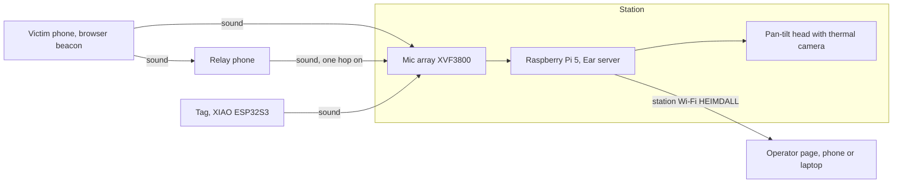
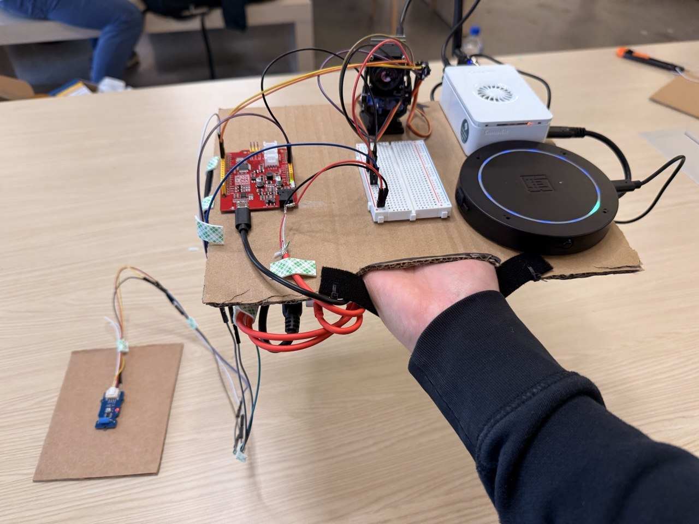
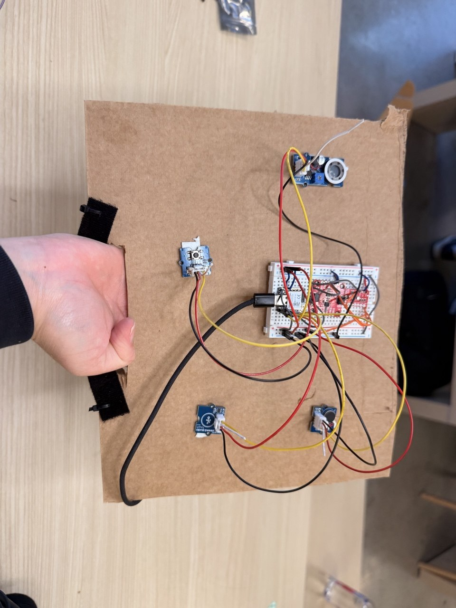

# Heimdall

**Hears who you can't see.**

A trapped person's phone, or our small Tag, plays a coded chirp; a station on the ground finds where the sound comes from, turns a thermal camera to look, and shows the rescuer which way to walk and who is most urgent. It is built for search teams after a collapse or in a denied area, where survivors are out of sight and radio and cell networks are down or jammed. Everything runs on the devices themselves, a Raspberry Pi 5, an ESP32 and phone browsers, with no internet, no cell network and no cloud.

Code Metal Forge 2026, Team 31.

## The system in one picture

Sound carries the call from the victim to the station; the station's own Wi-Fi carries the result to the rescuer.



## The real thing

The station prototype, carried on the back of the hand: mic array and Raspberry Pi 5 at the back, the thermal camera on its pan-tilt head in front, the Seeeduino that drives the head on the left. The knock sensor lies on the table at the end of its lead.



The Tag: a XIAO ESP32S3 and an IMU on a breadboard, with a Grove speaker, SOS button, touch pad and vibration motor around them. More photos and every pin in [`docs/HARDWARE.md`](docs/HARDWARE.md).



## Videos

Both are on Google Drive, open to anyone with the link.

| Video | What it shows |
|---|---|
| [Student-made demo](https://drive.google.com/file/d/1mWrAioiMpH-IkVxtwFYfw7j0TqQf2ywm/view?usp=share_link) (1 min 13 s) | Shot by the team at the venue: the station carried on the hand and set down on the cardboard stage, a phone with its SOS page in the rubble, the operator page on a laptop, and a teammate climbing into the rubble box. |
| [Drone Operator Interface in the browser](https://drive.google.com/file/d/10pCqzMLARjKWCjvsHLSTGK8iDbOKLPA5/view?usp=sharing) (screen recording, 78 min, unedited) | The operator page (`web/operator.html`) as it looks in a browser on the station's Wi-Fi: the direction banner, the thermal picture and the triage list. |

## Live today

- Chirps from phones and the Tag
- Direction finding from the 4 raw mics
- The head that turns by itself to the most urgent victim, and starts straight
- The thermal picture with warm spots boxed
- The triage list on the operator page
- Relay between phones

## Next

- LoRa link to a command post
- Knock-back to the Tag, and knock sensing at the station (built, cut from the demo)
- Radar for a silent victim's chest motion
- Flying the drone
- Temperatures in degrees C (the thermal picture is brightness only today)
- Phones relaying the Tag (phones can't decode the Tag's sound yet; the station can)

## Where to look

| Path | What |
|---|---|
| [`docs/ARCHITECTURE.md`](docs/ARCHITECTURE.md) | software blocks, the path of one chirp, how the head picks a target, the network |
| [`docs/HARDWARE.md`](docs/HARDWARE.md) | station block diagram, Tag pinout, servo board pinout and serial commands, calibration |
| [`docs/PROTOCOL.md`](docs/PROTOCOL.md) | the HEIMDALL-AC1 acoustic frame, bands, decoding without machine learning, the three implementations |
| [`docs/SPEC.md`](docs/SPEC.md) | the contract every part follows: frame, angles, events, serial |
| [`ear/`](ear/) | the station server (Python, runs on the Pi) |
| [`web/`](web/) | the phone and operator web app |
| [`firmware/`](firmware/) | the Tag (`tag/`) and the head controller (`servo_knock/`) |
| [`modem/`](modem/) | the Python reference modem and the cross-language tests |
| [`pitch/deck_v3.pdf`](pitch/deck_v3.pdf) | the pitch deck (11 slides) |
| [`pitch/`](pitch/) | script, Q&A, earlier decks |

## Why the name

In Norse myth Heimdall is the watchman of the gods: he guards the bridge Bifrost, sees a hundred leagues by night and day, and hears grass growing on the earth and wool growing on sheep. Our station does the small human version: it listens for the faintest call and raises the alarm.

---

Victims (phones running our web app, or small ESP32 Tags) play a coded acoustic chirp. The Heimdall station (Raspberry Pi 5 + mic array + thermal camera on a pan-tilt head) finds the chirp's direction and shows it to the drone operator on a phone web app served over the station's own Wi-Fi hotspot.

The contract for every part is [`docs/SPEC.md`](docs/SPEC.md). Read it first. The plan is [`PLAN.md`](PLAN.md).

## Team
Namig Mirzayev, Mikael Aznauryan, Erdeni Iles, Giorgi Mumladze

## Layout
```
docs/SPEC.md      the contract (frame format, angles, events, serial, LoRa)
ear/              station server (Python, runs on the Pi)
  bus.py          in-process publish/subscribe
  main.py         starts modules + server
  server.py       FastAPI: web app, /ws, /thermal.mjpg, /api/state
  config.py       one dict; HEIMDALL_MODULES overrides the module list
  modules/        one file per sensor (mock.py fakes all of them)
  tools/          make_cert.sh, net_mode.sh, heimdall.service, hw_smoke/
  certs/          TLS certs (gitignored, made on the Pi)
web/              phone web app (served by the Ear); debug.html = raw event view
firmware/         ESP32 Tag, Seeeduino servo/knock
modem/            acoustic modem (Python reference)
command/          command post (LoRa receiver)
pitch/            pitch material
```

## Running the Ear
On the Pi (`ssh heimdall@heimdall`, see "Getting into the Pi" below):
```bash
cd ~/Team-31 && source ~/heimdall-venv/bin/activate
ear/tools/make_cert.sh                      # once (certs last 30 days; --force to remake)
HEIMDALL_MODULES=mock python -m ear.main    # Ctrl-C to stop
```
On a laptop: `pip install fastapi "uvicorn[standard]" numpy opencv-python-headless`, then the same commands.

- Modules come from `ear/config.py` (`"modules": ["mock"]`) or env `HEIMDALL_MODULES=mock,thermal`.
- With `mock` plus a real module (e.g. `mock,thermal`), the mock stops faking that module's events, so you can bring sensors up one at a time.
- Test one module alone, events printed as JSON lines: `python -m ear.modules.mock`.
- As a service (demo day): `ear/tools/demo_up.sh`, see "Demo day" below (`journalctl -u heimdall -f` for logs).

### Endpoints (port 8443, HTTPS)
| Path | What |
|---|---|
| `/` | `web/index.html` (redirects to `/debug.html` until it exists) |
| `/debug.html` | raw event log, victims table, thermal video, pan buttons |
| `/ws` | WebSocket. On connect: every known victim + last event of each type, then live events. Send JSON (`pantilt_cmd`, `pantilt_mode`, `heard`) and it goes on the bus as-is. Events: SPEC section 3. |
| `/thermal.mjpg` | MJPEG, up to 10 fps |
| `/api/state` | `{"victims": {...}, "last": {type: event}}` |
| `/ca.crt` | the local CA, to install on a phone (see below) |

## Demo day
**Start the demo** as the systemd service (survives SSH, restarts after a crash, and with `--boot` comes back by itself after a power cut: measured 51 s from plug-in to the first decoded frame, hotspot included):
```bash
ear/tools/demo_up.sh --relay AAAA --bands 0,3 --acc 3 --boot
```
- `--relay <id>` is the relay demo switch: the station drops that id's direct (hops-0) frames, so its card only appears when phone C passes it on ("Via relay"). Whatever Beacon ID the top of phone A's page shows, that is the id after `--relay` (the script says AAAA; the id is kept in the phone's browser storage, so only another phone or a cleared browser gets a new one).
- `--bands 0,3 --acc 3`: bearings from bands 0 and 3 only, summed over the last 3 frames of an id. Measured on demo morning: bands 1 and 2 put the Tag on the mirror side (−59° for +52°) about one frame in three, bands 0 and 3 never did. Other frames keep the id's last direction.
- Modules default to `audio,pantilt,thermal`, never the mock (it would put fake data in front of the judges). `--modules audio` for sound only.
- It prints the module health after 8 s and the phone/operator URLs. Settings go to `~/heimdall.env`, read by the unit.
- `sudo` without a password for the service commands: once, `sudo install -m 0440 ear/tools/heimdall.sudoers /etc/sudoers.d/heimdall`.

**Back to development runs:** `ear/tools/demo_up.sh --stop` (stops and disables the service), then `ear/tools/restart_ear.sh [modules]` as before. `restart_ear.sh` refuses to start while the service runs, so two Ears never fight over the mic array.

**Relay-only phone (phone C):** `https://10.42.0.1:8443/victim.html?mode=relay`, tap **Start relay**. It listens and relays (two bands up; a relay-only phone passes on every frame it hears, a normal victim page relays an id at most once per 30 s) and sends no beacon of its own, so it never shows up as a victim. A normal victim page only listens and relays while its own SOS is on.

**Camera head calibration** (`pantilt` in `ear/config.py`, or per run `demo_up.sh --pan-dir -1 --pan-offset 30`): `pan_dir` is −1 when a positive servo pan turns the camera **left** (the servo mounted the other way round, as on the stage head), `pan_offset_deg` is the bearing the camera looks at with the servo centred (+30 on the stage head, measured 09:20 Sunday). Check it on the operator page: switch to Manual, pan to the Tag's bearing from its card, and the Tag's pile must sit in the middle of the thermal picture. Picture on the wrong side: flip `pan_dir`. Off by a constant: change the offset. Everything the Ear publishes (the dial, `pantilt` events, thermal boxes) stays in bearing degrees; only the number sent to the board changes. **Tape the camera to the servo horn**: every time it is turned by hand, the offset is wrong again.

**Getting in:** `ssh heimdall@heimdall.local` on the venue Wi-Fi (plain `heimdall` only resolves over Tailscale); `ssh heimdall@10.42.0.1` on the HEIMDALL hotspot.

**Honest limits**
- Direction is weak behind the station (quiet, and reflections win), so bearings more than 95° from the front arrow are dropped as reflections and the id keeps its last direction. Nothing may chirp behind the station on stage.
- The relay demo ignores one id's direct signal on purpose: the room is small enough for the station to hear everyone.
- A relayed frame's direction is the relaying phone's, not the victim's. That is why phone C stands next to pile A: phone A's card then points at the right pile.
- Each band reflects differently off the room. The kept bands are the ones that agreed with the tape marks on demo morning, so a new room means measuring again: the `frame ... raw bearing` lines in the log, two frames per band per pile, within 15° of the truth at both piles.
- The camera pans ±90° around its zero: on the stage head (zero +30°) it reaches bearings −60° to +120°. A victim further round gets the edge, and the dial and the thermal boxes show that edge, not the victim's true direction. The thermal box's `deg` assumes the camera looks exactly where the head was sent, so it is only as good as the calibration above.
- After a power cut the phones and the laptop may drift back to the venue Wi-Fi: turn auto-join off for every other network.

## Module contract
Every sensor is one file in `ear/modules/`, owned by one person:
```python
# ear/modules/<name>.py
def run(bus, cfg: dict) -> None:   # blocking loop. main.py runs it in a daemon thread and restarts it
                                   # 3 s after any exception (logs the traceback, health shows "error")
if __name__ == "__main__":         # standalone test:  python -m ear.modules.<name>
    from ear.bus import PrintBus
    run(PrintBus(), {})
```
- `cfg` is that module's section of `ear/config.py` (e.g. `CONFIG["thermal"]`); `{}` in standalone tests, so have defaults.
- Publish events: `bus.publish({"t": "thermal_det", ...})`. `ts` is filled in if you leave it out. Field names and types **exactly as in `docs/SPEC.md` section 3**.
- Listen: `bus.subscribe("pantilt_cmd", fn)` (or `None` for everything). `fn(event)` runs in its own thread with a 200-event queue (oldest dropped), so keep it quick and never block the publisher.
- Video: `bus.set_frame(jpeg_bytes)`; the server streams the latest frame.
- Returning from `run()` without an exception means "nothing to do" (e.g. no device found): health shows `off` and it is not restarted. Raise if you want a retry.
- `health` (every 5 s): `ok` running, `error` crashed or import failed, `off` returned or not enabled.

## Audio (mic array)
`ear/modules/audio.py`: Seeed **reSpeaker XVF3800 USB 4-Mic Array** (round case) → HEIMDALL-AC1 decode → GCC-PHAT bearing → `bearing`, `victim`, `noise` events. Run with `HEIMDALL_MODULES=mock,audio` (the mock then stops faking those). Standalone: `python -m ear.modules.audio` (or `--wav rec.wav` to replay a 6-channel recording).

**Plug in:** the USB-C **next to the 3.5 mm jack** (the XMOS port), straight into the Pi. The other USB-C belongs to the XIAO ESP32 board and shows up as "Espressif", not as a mic. Red LED = muted (button on the case) = silence on every channel.

**Firmware:** our kit (with XIAO) shipped with **I2S firmware, which is not a USB device at all**. It is flashed with Seeed's **`respeaker_xvf3800_usb_dfu_firmware_v2.1.1_16k6ch.bin`** (6 channels, 16 kHz: ch0 conference, ch1 ASR, **ch2-5 raw mics**). To reflash: unplug, **hold the mute button while plugging it back in** (red LED blinks = Safe Mode), then `bash ear/tools/audio/flash_xvf3800.sh` (asks for the Pi password). Check: `arecord -l` lists "reSpeaker XVF3800 4-Mic Array", and `python ear/tools/audio/xvf_probe.py --list` says 6 inputs.

**Geometry** (seen from above, cable at 6 o'clock, **front = 12 o'clock = bearing 0**, +90 = right, SPEC 2). The mic holes are the corners of a **6.65 cm square** (9.35 cm diagonal):

| Channel | Hole | (x, y) m |
|---|---|---|
| ch4 | 10:30 front-left | (+0.03325, −0.03325) |
| ch5 | 1:30 front-right | (+0.03325, +0.03325) |
| ch2 | 4:30 back-right | (−0.03325, +0.03325) |
| ch3 | 7:30 back-left | (−0.03325, −0.03325) |

Mount it flat on the mast with the **cable pointing to the back of the station** and a pen mark at 12 o'clock on the front arrow. Keep anything taller than the puck 10 cm away. If the front ever reads off, set `audio.bearing_offset_deg` in `ear/config.py`.

**Calibrate / test:** `ssh -t heimdall@heimdall 'bash ~/Team-31/ear/tools/audio/calibrate.sh'`. It walks you through phone positions: on `modem_test.html`, band 1, tap **Play burst** (every 3 s), press Enter at each spot, and it prints mean ± std + decode rate and saves `~/calib/*.wav`. For one spot: `python ear/tools/audio/doa_test.py --true 90`. Unit tests: `python -m pytest ear/tools/audio/test_doa.py`.
- **Line of sight matters.** A laptop or a person between the phone and the puck made "behind" read as "front" in our tests (a reflection beats the blocked direct path). With a clear path, behind read −179°.
- **Point the phone's speaker (its bottom edge) at the puck.** Facing away, the strongest sound at the puck was a wall reflection: left read −19° instead of −90°; pointed at the puck it read −99.7 ± 0.5.
- Calibration at 2 m (true → mean ± std, decoded): 0 → +1.4 ± 0.4 (95%), +90 → +86.6 ± 0.9 (95%), +45 → +53.7 ± 1.0 (95%), 180 → about −177 (16%: quiet from behind), −90 → −99.7 ± 0.5 (95%). At 4 m: 0 → 4° off, +90 → +89.5 ± 1.5 (95%).

**Relay demo switch:** on stage the station can hear the victim's phone directly, so to show a relay: `HEIMDALL_IGNORE_DIRECT=1A2B ear/tools/restart_ear.sh`. The station drops 1A2B's **hops-0** frames (one log line each) and shows the relayed copy as "1A2B (via relay)". Turn it off with a plain `ear/tools/restart_ear.sh`. Permanent version: `audio.ignore_direct_ids` in `ear/config.py`. As the service: `ear/tools/demo_up.sh --relay 1A2B` (see "Demo day").

**Rules it follows:** a new id is `confirmed: false` until a second frame within 60 s, then stays confirmed; an unconfirmed id is dropped after 60 s (SPEC 1.7.6). One record per id: a relayed copy only refreshes "last heard" if a direct frame came in the last 30 s. Relayed frames publish **no `bearing`** (their direction is the relaying phone's, not the victim's), so auto-aim never points at a relay. A phone's `heard` report becomes a victim with `deg: null` if the station hasn't heard that id itself in 30 s. `noise` = mean power per band of the decode channel's last second (raw mic, so levels are low: about −70 to −100 dBFS in a quiet room).

**Restart the Ear** (always this way, so pkill can't hit your own SSH session): `ear/tools/restart_ear.sh [modules]` (default `mock,audio`, log `~/ear.log`). While the demo service runs it refuses; `ear/tools/demo_up.sh --stop` first.

## Field network
- The Pi runs Wi-Fi hotspot **`HEIMDALL`**, password **`heimdallforge26`**, Pi at **`10.42.0.1`**.
- Operator / victim phones join it and open **`https://10.42.0.1:8443/`** (debug: `https://10.42.0.1:8443/debug.html`). No internet on this network.
- Two radios at once (`ear/tools/net_mode.sh dual`, already set up, survives reboots): the **ALFA USB adapter** (`rtw88_8821au`, built into the kernel) stays on the venue Wi-Fi for internet + Tailscale, the **built-in Wi-Fi** runs the hotspot.
- Without the ALFA: `net_mode.sh dev|demo` switches the built-in Wi-Fi between venue Wi-Fi and hotspot (demo cuts internet and Tailscale; reconnect via `HEIMDALL` → `ssh heimdall@10.42.0.1`).
- The venue password contains a `$`: always put it in **single quotes** in shell commands (`password 'PASS'`), or the shell eats part of it.

## Getting into the Pi (SSH)
BASE-X Guest Wi-Fi blocks devices from talking to each other, so SSH goes through **Tailscale** (free).
1. Install Tailscale on your laptop (tailscale.com/download) and accept Namig's invite (he adds you under Users → Invite in the Tailscale admin).
2. `ssh heimdall@heimdall` (password from Namig), then `ssh-copy-id heimdall@heimdall` so you don't need it again.
3. On the hotspot (no Tailscale needed): join `HEIMDALL`, `ssh heimdall@10.42.0.1`.

The Pi has no GitHub login. Code gets there from Namig's laptop: `git remote add pi heimdall@heimdall:Team-31` once, then `git push pi <branch>` and `git checkout <branch>` on the Pi.

### Certificate warning (once per phone)
Phones only allow the microphone and motion sensors on HTTPS, and our cert is self-signed, so the browser warns once.

**Android Chrome:** open `https://10.42.0.1:8443/` → "Your connection is not private" → **Advanced** → **Proceed to 10.42.0.1 (unsafe)**. Chrome remembers this for a while; repeat if it warns again.

**iPhone Safari:** open `https://10.42.0.1:8443/` → "This Connection Is Not Private" → **Show Details** → **visit this website** → **Visit Website**.

**If the page loads but stays "disconnected"** (some iOS versions block the WebSocket even after the warning), install the CA once instead:
1. Open `https://10.42.0.1:8443/ca.crt` in Safari → **Allow** (profile downloaded).
2. Settings → General → **VPN & Device Management** → Heimdall Local CA → **Install**.
3. Settings → General → About → **Certificate Trust Settings** → enable **Heimdall Local CA**.

Android equivalent: download `/ca.crt`, then Settings → Security → Encryption & credentials → Install a certificate → CA certificate.

The certs expire after 30 days; `ear/tools/make_cert.sh --force` makes new ones (phones that installed the CA must reinstall it).

## Working on the repo
- One branch per task: `<person>/<TASK>` (e.g. `erdeni/E1-station`).
- Only commit your own paths.
- Never commit to `main`. Push your branch; Namig merges.
