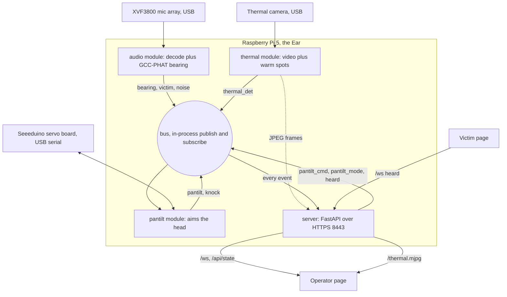
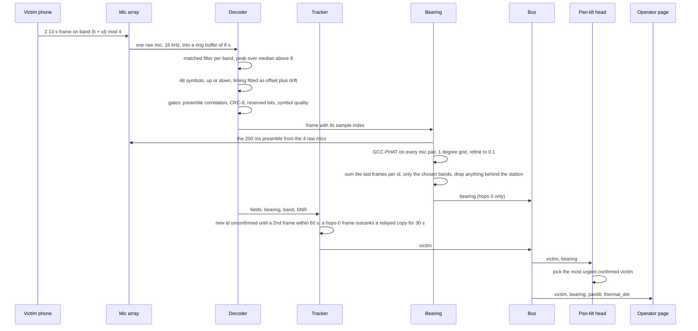
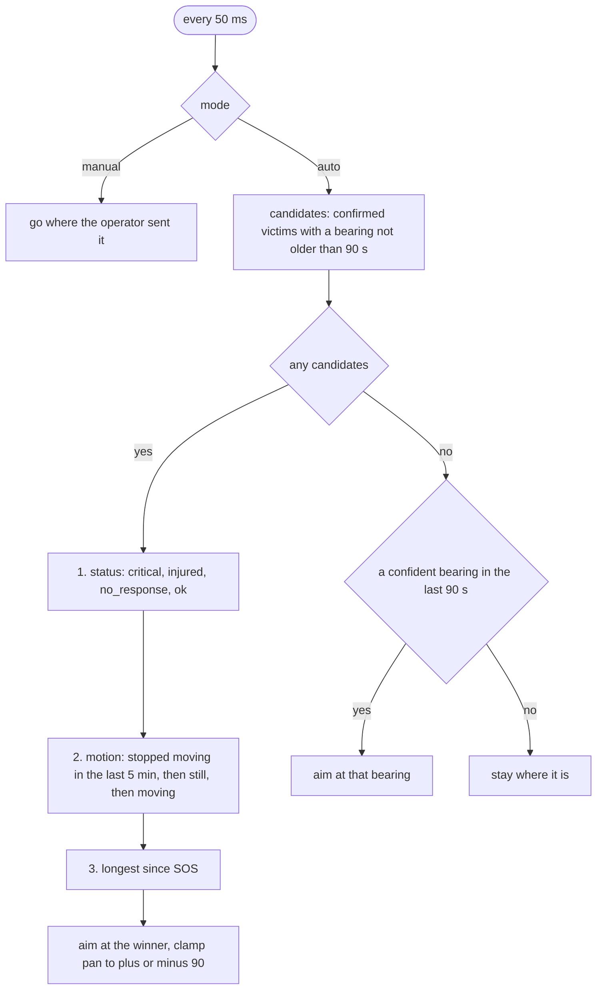

# Architecture

How the software fits together. Every number here comes from the code: `ear/`, `web/`, `firmware/`, `modem/`, and the contract in [`SPEC.md`](SPEC.md).

## Software blocks

The Ear is one Python process on the Pi. Each sensor is a module that publishes events on an in-process bus; the server fans the same events out to every page over a WebSocket.

The bus (`ear/bus.py`) is a plain publish and subscribe: every subscriber gets its own worker thread and a 200-event queue that drops the oldest when full, so a slow consumer never blocks a sensor. `main.py` runs each module's `run(bus, cfg)` in a daemon thread and restarts it 3 s after a crash; a `health` event every 5 s says which modules are `ok`, `error` or `off`.

### Events on the bus

Field names and types are fixed in [SPEC section 3](SPEC.md#3-ear-events-websocket-ws-json-one-object-per-message). What each module publishes:

| Module | Publishes | Listens to |
|---|---|---|
| `audio` | `bearing`, `victim`, `noise` | `heard` (a phone's report of what it decoded) |
| `pantilt` | `pantilt`, `knock` | `victim`, `bearing`, `pantilt_cmd`, `pantilt_mode` |
| `thermal` | `thermal_det`, and the JPEG frame for `/thermal.mjpg` | `pantilt` (to put a bearing on each warm box) |
| `main` | `health` | |

### Endpoints

All on port 8443, HTTPS with a self-signed certificate made on the Pi (`ear/tools/make_cert.sh`).

| Path | What |
|---|---|
| `/` | `web/index.html`, the role chooser (victim or operator) |
| `/victim.html` | the beacon page; `?mode=relay` makes it a relay-only phone |
| `/operator.html` | the rescuer's page: direction, thermal picture, triage list |
| `/debug.html` | raw event log |
| `/ws` | WebSocket. On connect: every known victim plus the last event of each type, then live events. A page may send `pantilt_cmd`, `pantilt_mode` or `heard`; the server stamps `ts` and puts it on the bus |
| `/thermal.mjpg` | MJPEG, at most 10 frames per second |
| `/api/state` | `{"victims": {...}, "last": {type: event}}` |
| `/ca.crt` | the local CA, for phones that want no certificate warning |

## The path of one chirp

From a phone playing a frame to the operator page and the camera head.

The decoder is the Python reference modem (`modem/heimdall_ac1.py`), fed one raw mic channel. The bearing uses the other three raw mics with it (`ear/modules/audio.py`, `estimate_bearing`): GCC-PHAT with a whitening exponent of 0.7 rather than full PHAT, 16 times upsampled lags, and a score over every angle from −180 to 180 in 1 degree steps, refined to 0.1 degree. With `doa_accumulate` above 1 the score curves of the last frames of the same id are summed before the peak is read, so a reflection that only one band sees does not win. Bearings further than `doa_front_deg` (95 degrees) from the front arrow are dropped as reflections and the id keeps its last direction.

The Tracker (`ear/modules/audio.py`, class `Tracker`) keeps one record per id. A new id is published with `confirmed: false` and forgotten after 60 s unless a second valid frame arrives; once confirmed it stays confirmed. A relayed copy (hops above 0) of an id heard directly in the last 30 s only refreshes "last heard"; its direction is the relaying phone's, not the victim's, so relayed frames never publish a `bearing`. A phone's `heard` report about an id the station decoded itself in the last 90 s refreshes the fields only, never the direction.

## How the head picks who to look at

From `ear/modules/pantilt.py`, `Aimer.target` and `motion_rank`. The operator page ranks its list the same way (`web/js/ui-operator.js`), so the head and the list agree.

Two details keep the head calm. It does not re-aim for a change under 4 degrees of pan, and it waits at least 1.5 s between moves (`min_move_deg`, `hold_s`). A bearing counts as confident at `conf` of 0.3 or more. "Stopped moving" is detected by the head itself: a victim whose `motion` flag goes from true to false gets a timestamp, and for 5 minutes (`STOP_WINDOW_S`) outranks everyone of the same status.

The head starts straight ahead when the Ear starts and is sent straight ahead again when the Ear stops, so a run never begins where the last one left it. The mount is corrected in software, not in the firmware: `servo_pan` applies `pan_dir` and `pan_offset_deg` from `ear/config.py` to turn a bearing into a servo angle, and everything else (events, the dial, thermal boxes) stays in bearing degrees. See [HARDWARE.md](HARDWARE.md) for the calibration.

## Network

The station is its own network. Nothing on it reaches the internet.

| | |
|---|---|
| Wi-Fi | hotspot `HEIMDALL` on the Pi's built-in radio (`ear/tools/net_mode.sh`) |
| Pi address | `10.42.0.1` |
| App | `https://10.42.0.1:8443/`, HTTPS because phones only allow the microphone and motion sensors on a secure page |
| Certificate | self-signed, made on the Pi; the CA is served at `/ca.crt` |
| Service | `heimdall.service` (systemd), `Restart=always` with a 3 s delay, started by `ear/tools/demo_up.sh`; settings in `~/heimdall.env` |

For development a second USB Wi-Fi adapter joins the venue network at the same time (`net_mode.sh dual`), so the Pi keeps internet and SSH while the hotspot runs. On demo day the service brings the station back by itself after a power cut (`demo_up.sh --boot`).
