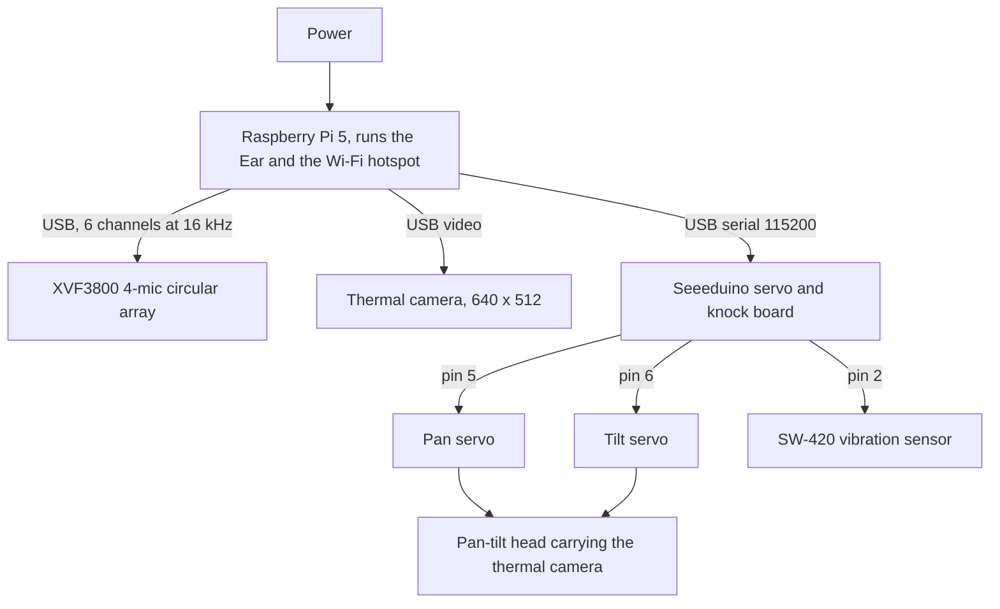
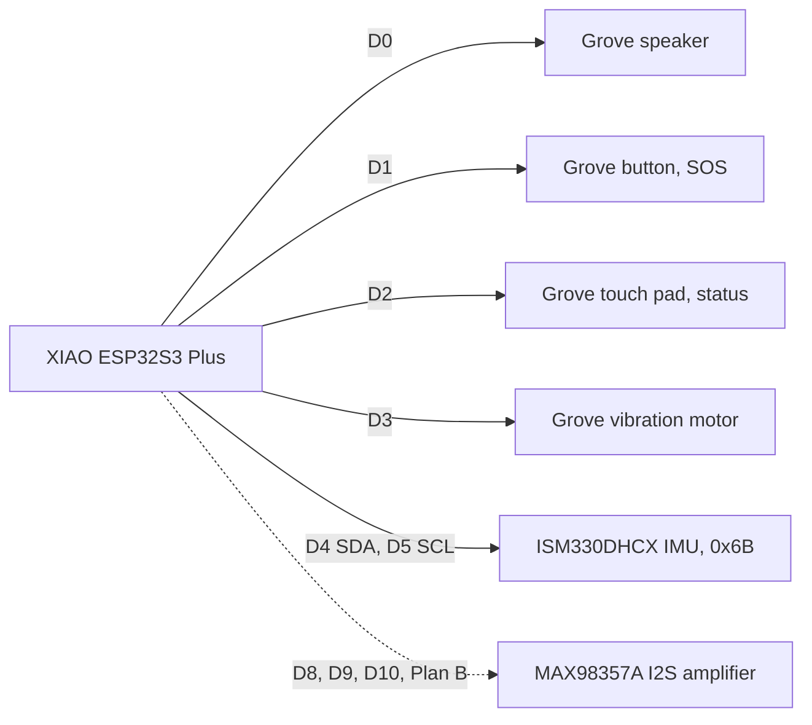

# Hardware

The station, the Tag and the servo board. Pins and numbers are taken from `firmware/tag/tag.ino`, `firmware/servo_knock/servo_knock.ino`, `ear/config.py` and the module files in `ear/modules/`.

## Station

A Raspberry Pi 5 with three USB devices: the mic array, the thermal camera and the Seeeduino that drives the head.

| Part | Detail | Source |
|---|---|---|
| Mic array | Seeed reSpeaker XVF3800 USB 4-Mic Array, round case, flashed with the 6-channel 16 kHz USB firmware: ch0 conference, ch1 speech (ASR), ch2 to ch5 the raw mics. Plug it straight into the Pi. | `README.md`, `ear/config.py` |
| Mic geometry | the four holes are the corners of a 6.65 cm square (9.35 cm diagonal) | `ear/config.py` `mic_xy` |
| Thermal camera | USB UVC, 640 x 512 YUYV, read as brightness only (no temperatures) | `ear/modules/thermal.py` |
| Head | two servos, pan −90 to +90, tilt −30 to +60 at the board; the Ear sends tilt −30 to +25 | `servo_knock.ino`, `pantilt.py` |
| Knock sensor | SW-420 on the servo board; built, not in the demo | `servo_knock.ino` |

## Tag

Board: Seeed XIAO ESP32S3 Plus (`tag.ino` line 2) with Grove modules. It plays the same HEIMDALL-AC1 frame as a phone, every 8 s plus or minus 1 s, id `A001`.

| XIAO pin | Grove module | Purpose |
|---|---|---|
| D0 | Speaker (SIG) | plays the chirp. 8-bit PWM, driven as a square wave at the chirp's own frequency |
| D1 | Button (SIG) | SOS on and off |
| D2 | Touch pad (SIG) | next status: ok, injured, critical, no_response |
| D3 | Vibration motor (SIG) | feedback buzz: 1, 2 or 3 pulses for ok, injured, critical; one long pulse for no_response |
| D4 | IMU SDA | ISM330DHCX accelerometer and gyro at I2C address 0x6B |
| D5 | IMU SCL | |
| D8, D9, D10 | I2S BCLK, LRCLK, DIN | Plan B audio, optional: a MAX98357A amplifier board instead of the Grove speaker (`AUDIO_OUT AUDIO_I2S`) |

What the firmware does with them (`tag.ino`):

- The frame plays from a 16 kHz timer interrupt, 34080 samples for 2.13 s. Sample clock: exactly 16000 Hz from the 80 MHz APB clock.
- Motion: the IMU is read at 50 Hz. A change of more than 0.08 g in the acceleration magnitude or a turn faster than 20 degrees per second counts as moving; the frame's motion bit means "moved in the last 20 s". The IMU is ignored while the speaker or motor runs, and for 300 ms after.
- The button and touch pad are ignored while a frame plays, because the speaker current made them fire by themselves on the hardware.
- Fields the Tag always sends: people 1, battery 3, floor unknown, hops 0, knock 0. Status starts at injured; the beacon starts at power-on.
- Serial at 115200 for debugging: `s` SOS on or off, `t` one frame now, `b` burst mode (every 3 s on band 1, for direction tests), `0` to `3` status, `m` motion readout.

## Servo and knock board

A Seeeduino on USB serial, protocol in [SPEC section 4](SPEC.md#4-station-servo--knock-controller-seeeduino-usb-serial-115200-lines-end-with-n).

| Seeeduino pin | Connected to |
|---|---|
| 2 | SW-420 vibration sensor (digital out) |
| 5 | pan servo signal |
| 6 | tilt servo signal |
| USB | serial to the Pi, 115200 baud, lines end with newline |

The board moves at most 2 degrees every 15 ms (about 130 degrees per second), so the head slews rather than jumps. Knocks closer than 120 ms count as one; a group ends after 1.5 s of quiet and is reported once.

Pi to board:

| Command | Meaning | Reply |
|---|---|---|
| `PING` | alive? | `PONG` |
| `P <pan> <tilt>` | integer degrees, pan −90 to 90, tilt −30 to 60 | `OK P <pan> T <tilt>` |
| `R <ch> <raw>` | raw servo angle 0 to 180, ch 0 pan, 1 tilt, for calibration | `OK R <ch> <raw>` |
| `C <pan_center_raw> <tilt_level_raw>` | set the calibration until reboot | `OK C <a> <b>` |
| `?` | state | `STATE P <pan> T <tilt> C <a> <b> IDLE <0/1>` |

Board to Pi, unprompted:

| Line | Meaning |
|---|---|
| `HELLO HEIMDALL-SERVO 1` | after boot. The Ear re-homes and re-aims when it sees this |
| `KNOCK <count>` | a group of knocks ended |
| `ERR <line>` | a command it did not understand |

## Mic array orientation

Seen from above with the USB cable at 6 o'clock, the front arrow is 12 o'clock and bearing 0. Positive bearings are to the right. Mount the array flat with the cable pointing to the back of the station and keep anything taller than the puck 10 cm away. If the front ever reads off by a constant, set `audio.bearing_offset_deg` in `ear/config.py`.

| Channel | Hole | (x, y) m |
|---|---|---|
| ch4 | 10:30 front-left | (+0.03325, −0.03325) |
| ch5 | 1:30 front-right | (+0.03325, +0.03325) |
| ch2 | 4:30 back-right | (−0.03325, +0.03325) |
| ch3 | 7:30 back-left | (−0.03325, −0.03325) |

## Head calibration

The camera's zero is not the mic array's zero, and a servo can be mounted facing either way. Both are fixed in `ear/config.py` under `pantilt`, not in the firmware, so nothing else in the system has to know:

- `pan_dir` is −1 when a positive servo pan turns the camera left (the servo mounted the other way round), otherwise 1.
- `pan_offset_deg` is the bearing the camera looks at with the servo centred. On the stage head it is +30.

The Ear turns a bearing into a servo angle as `pan_dir * (bearing - pan_offset_deg)`, clamped to −90 to 90. To check: on the operator page switch to Manual, pan to a known victim's bearing, and that victim's pile must sit in the middle of the thermal picture. Picture on the wrong side: flip `pan_dir`. Off by a constant: change the offset. Both can be set per run with `demo_up.sh --pan-dir -1 --pan-offset 30`. Tape the camera to the servo horn; every time it is turned by hand the offset is wrong again.
