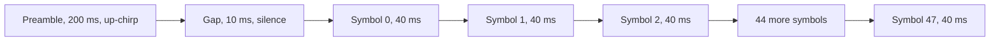

# Protocol: HEIMDALL-AC1

The acoustic frame a victim's phone or Tag plays, and how the station pulls it out of the noise. The binding definition is [SPEC section 1](SPEC.md#1-acoustic-frame-heimdall-ac1); the reference code is `modem/heimdall_ac1.py`.

## One frame

A frame is 2.13 s of linear frequency chirps: a preamble, a short gap, then 48 data symbols with no gaps between them.

| Part | Duration | Content |
|---|---|---|
| Preamble | 200 ms | up-chirp from the band's low to high frequency |
| Gap | 10 ms | silence |
| 48 symbols | 40 ms each, 1920 ms | bit 1 is an up-chirp, bit 0 a down-chirp |
| Total | 2130 ms | 34080 samples at 16 kHz |

Each segment restarts its phase at 0 and is faded in and out with a raised cosine: 5 ms for the preamble, 2 ms for a symbol. Peak amplitude is 0.8 of full scale. Why 40 ms symbols: in a simulation with 5 dB SNR and a 0.4 s reverberation time, 40 ms symbols decoded about 95 percent of frames and 25 ms symbols about 75 percent. Indoor halls echo, so the frame spends 0.7 s more on air for reliability.

### The 48-bit payload

Bytes 0 to 4 are a 40-bit big-endian integer; byte 5 is a CRC-8 over them (polynomial 0x07, init 0, no reflection, no final XOR; the CRC of `123456789` is 0xF4). On air, byte 0 goes first, most significant bit first.

| Field | Bits | Encoding |
|---|---|---|
| id | 16 | beacon ID, shown as 4 hex digits |
| floor | 5 | 0 unknown; else floor is code minus 2, so −1 to 29 |
| min2 | 6 | minutes since SOS divided by 2, capped at 63 |
| motion | 1 | moved in the last 60 s (normal) or 20 s (demo) |
| status | 2 | 0 no_response, 1 ok, 2 injured, 3 critical |
| people | 3 | 0 to 7, where 7 means 7 or more |
| battery | 2 | quarters, 0 to 3 |
| hops | 2 | 0 original, 1 to 3 relayed that many times |
| knock | 1 | this beacon heard rescuer knocks in the last 2 min |
| reserved | 2 | 0 |

Two test vectors (SPEC 1.4) pin every implementation to the same bytes. Vector 1, id 1A2B, floor 2, 14 minutes, moving, injured, 2 people, battery 3, no hops, no knock: `1A 2B 20 F9 60 66`. Vector 2, id 77C1, floor unknown, 61 minutes, still, critical, 1 person, battery 1, 1 hop, knock: `77 C1 03 CC AC EA`.

## Bands and timing

| Band | Low (Hz) | High (Hz) |
|---|---|---|
| 0 | 1500 | 2500 |
| 1 | 2500 | 3500 |
| 2 | 3500 | 4500 |
| 3 | 5000 | 6500 |

Everything stays below 7 kHz so the mic array's 16 kHz recording captures it. The Tag plays at exactly 16 kHz; a phone plays at its browser's audio rate, usually 48 kHz; each receiver builds its templates at its own capture rate. The math is in continuous time, so the rates do not have to match.

- Period: 8 s in demo mode (the hackathon default), 30 s in normal mode, with random jitter of plus or minus 1 s so two beacons do not collide forever.
- Band hopping: transmission number k goes out on band `(k + id) mod 4`, so each frame of a beacon moves to the next band.
- Relay: a phone that decodes another phone's frame with hops below 3 waits a random 1.5 to 4.0 s, waits again if it hears a preamble (at most 3 times), then plays the same payload with hops plus 1 and a fresh CRC, two bands up: `(received band + 2) mod 4`. It relays each id at most once per 30 s and never plays two frames at once. A relay-only phone (`victim.html?mode=relay`) sends no beacon of its own and has no 30 s hold-off.
- Burst mode, for direction tests only: every 3 s, always band 1.

## Pulling a frame out of the noise

There is no machine learning anywhere in Heimdall. The decoder is signal processing with numbers you can read in the source, retuned from live recordings.

The mic array has a built-in speech channel that cleans up voices. We tried decoding from it first. It is built to keep speech and remove steady tones, so it treated our chirps as noise: 29 to 48 percent of frames decoded at 2 to 4 m, against 87 to 96 percent from a raw mic (`ear/config.py`, `decode_channel`). So the station decodes from one raw mic and does its own cleaning:

1. Chirp spread spectrum, the idea behind LoRa, in sound. Each band is matched-filtered against its preamble template (the 4th-order Butterworth band-pass of SPEC 1.7.1 is folded into the template). A preamble is detected when the correlation peak is more than 8 times the median over the last 2 s. The matched filter pulls a frame out of noise you can hear over it.
2. Non-coherent symbol decisions. For each symbol the magnitude of the correlation with the up template and the down template is compared; the bigger one wins. Coherent, real-valued correlation fails under reverberation. The 48 symbol times are fitted as one line, offset plus drift, so a clock error up to 0.15 percent is tracked; each symbol is then searched within 0.25 ms of that line.
3. Gates before a frame is reported: a normalized preamble correlation of at least 0.25 (rejects leakage from a neighbouring band and clicks), the CRC-8, the two reserved bits equal to 0, and a mean symbol margin of at least 0.20.
4. Confirmation. The CRC plus the reserved bits still pass about 1 in 1024 garbage decodes, so the Ear treats a new id as unconfirmed until a second valid frame with the same id arrives within 60 s. Four bands with hopping and a CRC-8 on every frame keep callers from colliding and bad frames from counting.

For direction the station uses the same frame on all four raw mics:

- GCC-PHAT between every mic pair, limited to the frame's band, with the whitening exponent set to 0.7 rather than 1. Full whitening let reverberation pick a neighbouring cycle of the carrier on some pairs.
- Lags interpolated 16 times: at 16 kHz one sample is 2.1 cm of sound travel, too coarse for a 6.65 cm array.
- Every angle from −180 to 180 degrees is scored in 1 degree steps and the best is refined to 0.1 degree.
- Score curves of the last frames of the same id are summed before the peak is read (`doa_accumulate`), and only the bands that agreed with the tape marks on demo morning give a bearing (`doa_bands`, bands 0 and 3 on stage). Each band reflects differently off the room; the true direction is the one the bands agree on.
- Bearings further than 95 degrees from the front arrow are dropped as reflections (`doa_front_deg`); nothing chirps behind the station on stage.

Measured at 2 m (true to measured, mean and spread): 0 to +1.4 ± 0.4, +45 to +53.7 ± 1.0, +90 to +86.6 ± 0.9, −90 to −99.7 ± 0.5. At 4 m: 0 within 4 degrees, +90 to +89.5 ± 1.5 (`README.md`, Audio).

## One algorithm, three implementations

The modem was written once as a Python reference, then carried to the two other places it has to run. This is the part of Heimdall closest to what Code Metal does: research code moved to the edge and checked.

| Implementation | File | Does | Runs on |
|---|---|---|---|
| Python reference | `modem/heimdall_ac1.py` | encode and decode, pure numpy | the Pi (the Ear decodes with it) and the laptop |
| JavaScript | `web/js/heimdall-modem.js` | encode and decode, mirrors the Python file function by function | the phone browser (decoding in a Web Worker) |
| C++ | `firmware/tag/heimdall_ac1.h` | encode only, header-only, no heap, at exactly 16 kHz | the ESP32 Tag |

How the tests keep them identical (`modem/tests`):

- `test_vectors.py`: the Python modem reproduces the SPEC 1.4 vectors byte for byte and bit for bit, the CRC check value, and rejects a bad CRC.
- `test_js.mjs`: the same vectors in Node against the JavaScript modem.
- `test_cross.py`: frames synthesized in JavaScript at 48 kHz decode in Python, frames synthesized in Python at 16 kHz decode in JavaScript, and on a hard stream (direct-to-reverberant ratio −8 dB, SNR −3 dB, 0.1 percent clock error, all four bands, where about half the frames are lost) the two decoders report the same frames, bytes, bands and timing within 0.5 ms, and the same candidate log of detections and outcomes.

The C++ encoder is checked differently. Its header states it matches the Python synthesizer sample for sample, and the Tag's frames were decoded by the Python decoder on all four bands in simulation (`tag.ino`). There is no automated C++ test in `modem/tests`; the station decoding the live Tag is the check on hardware.
